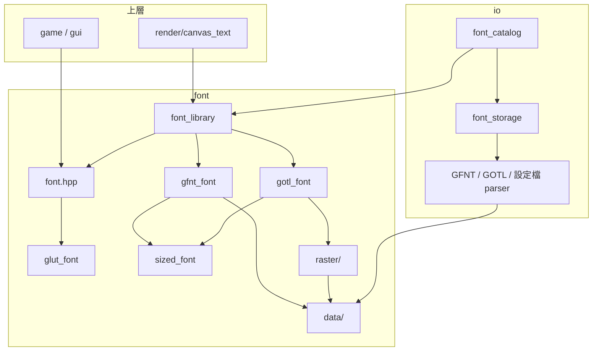

# 字型架構

使用方式見 [README.md](README.md)。這份文件說明各層的分工、資料的生命週期，以及為什麼這樣設計。

## 分層

```text
上層（game / gui / render）
  │  FontStyle = GlyphFontStyle | BitmapFontStyle | StrokeFontStyle
  ▼
font.hpp            主入口：GlyphFont、樣式、getFontWidth / getFontHeight
  │
  ├─ glut_font      GLUT 字型：查表的度量與寬度（相容用途）
  │
  └─ font_library   FontLibrary：依字號選擇字形來源，建立並保存 SizedFont
       │
       ▼
     sized_font     SizedFont：一個字號的字型；排版與量測的共用實作
       ├─ gfnt_font   GfntFont：直接使用事先點陣化的字形，可整數倍放大
       └─ gotl_font   GotlFont：用到時才點陣化輪廓，結果留在快取
            │
            ▼
          raster/     rasterizeGlyph：輪廓 → 8-bit alpha bitmap
            │
            ▼
          data/       GfntData / GotlData：載入後的檔案內容，與檔案格式版本無關
```

| 目錄 / 檔案       | 負責                                               | 不負責                     |
| ----------------- | -------------------------------------------------- | -------------------------- |
| `data/`           | 字形查表（二分搜尋、替代字元）、解碼輪廓           | 讀檔、驗證格式             |
| `raster/`         | 把一個字形點陣化成指定字號                         | 快取、選擇字形             |
| `gfnt_font`、`gotl_font` | 把字形換算成畫面像素的 `Glyph`              | 排版                       |
| `sized_font`      | UTF-8 解碼、換行、pen 推進、量測                   | 字形從哪裡來               |
| `font_library`    | 選擇字形來源、延遲載入、保存所有 SizedFont         | 檔案路徑、檔案格式         |
| `font.hpp`        | 上層使用的樣式與量測函式                           | 繪製                       |

讀檔與設定檔在 `io/`，繪製在 `render/canvas_text.cpp`，都不在 `font/` 內。

## 依賴關係



- **`io` 依賴 `font`，`font` 不依賴 `io`。** `FontLibrary` 只拿到「回傳 `GfntData` / `GotlData` 的函式」，不知道檔案在哪裡、是什麼格式版本。新增格式版本只要改 `io`。
- **上層只依賴 `font.hpp`。** `getFontWidth(GlyphFontStyle)` 宣告在 `font.hpp`，實作放在 `font_library.cpp`，上層因此不必引入 `FontLibrary`。

## 字形來源的選擇

一個 GlyphFont 可以有多個字號的 GFNT 與一份 GOTL。`FontLibrary::create` 依序選擇：

1. **有該字號的 GFNT**：直接使用。GFNT 保有 hinting，小字號比點陣化的 GOTL 清楚，因此「哪些字號用 GFNT」由設定檔提供了哪些字號決定，不需要另外設定門檻。
2. **有 GOTL**：點陣化成該字號。
3. **字號是某個 GFNT 字號的整數倍**：用能整除的最大 GFNT 字號放大，倍率最小，筆畫最細。

GOTL 排在整數倍放大之前：有輪廓的字型放大後應該是平滑的筆畫，只有像素字型（沒有 GOTL）才需要整數倍放大。

## 延遲載入與生命週期

```text
registerFonts（啟動）   只檢查檔案存在，FontLibrary 記下載入函式
fonts().get(style)      第一次用到某字型的某字號：
                          載入需要的 GfntData / GotlData（每個檔案只載入一次）
                          建立 SizedFont 並保存
glyph(codepoint)        GotlFont 第一次用到某字形時點陣化，存入快取
```

三層都只增不減，程式結束前不釋放：

| 層級          | 保存的內容                                 | key                    |
| ------------- | ------------------------------------------ | ---------------------- |
| `FontLibrary` | 每個字型的 `GfntData`、`GotlData`          | 字型、GFNT 字號        |
| `FontLibrary` | 每個字型各字號的 `SizedFont`               | 字型、字號             |
| `GotlFont`    | 點陣化後的字形                             | 實際使用的字形（替代後）|

因為不會釋放，回傳的參考與指標在程式執行期間都有效：

- `fonts().get()` 回傳的 `SizedFont&`：以 `unique_ptr` 保存，`unordered_map` 新增元素時不會搬動既有元素。
- `Glyph::alpha`：指向 `GfntData` 的 bitmap 或 `GotlFont` 快取中的 bitmap，同樣不會被搬動。

上層因此只需保存 `(字型, 字號)` 這種值，不必管理字型物件的生命週期。

點陣化快取的 key 是替代後實際使用的字形，所以不同的缺字都只對應一份 U+FFFD。以目前的文字量（標題、按鈕、HUD），快取只有幾十 KB，遠小於常駐的 GOTL 檔案（約 19 MB），因此沒有淘汰機制。

## 排版

`SizedFont::layout` 是 GFNT 與 GOTL 共用的唯一排版實作，`measureWidth` 也是由它算出，量測與繪製因此一定一致。

- pen 位置與字形的位移都是整數像素，排版不會累積浮點誤差。
- 第一行的基線在 `ascender`，每換一行往下 `lineHeight = ascender + descender`。
- 只有有墨跡的字形放進 `TextLayout::glyphs`，空白只推進 pen。
- `measureHeight` 只依行數計算，不查字形，GOTL 字型不會為了量高度而點陣化。

`Glyph` 同時描述畫面上的大小（`width`、`bearingX` 等，已乘上倍率）與 bitmap 本身（`bitmapWidth`、`scale`、`alpha`）。整數倍放大的 GFNT 不另外產生放大的 bitmap，而是交給繪製端以 `glPixelZoom(scale, -scale)` 放大。

## 繪製

`render/canvas_text.cpp` 的 `Canvas::drawText` 以 `std::visit` 分派到各種字型的繪製；`FontStyle` 新增型別而沒有對應的繪製時會編譯失敗。

- **對齊**：GlyphFont 只排版一次，同時得到文字框大小與字形位置，依 anchor 算出左上角後取整到整數像素。
- **raster position**：直接用 `glRasterPos` 時，只要那一點在畫面外，整個字都不會畫出。因此先把 raster position 設在一定有效的 viewport 中心，再用 `glBitmap` 位移到目標位置；位移不經過裁切，超出畫面的部分由 OpenGL 正常裁掉。GLUT bitmap 字型也使用同樣的方式。

GlyphFont 以 `glDrawPixels` 繪製每個字形的 alpha bitmap：

- 以 `GL_ALPHA` 格式送出時 RGB 視為 0，用 pixel transfer 的 bias 填入文字顏色、scale 乘上透明度，不需要在 CPU 上產生 RGBA。
- bitmap 的第一列在頂端，負的 Y zoom 讓 OpenGL 由上往下畫。
- 搭配 `GL_SRC_ALPHA, GL_ONE_MINUS_SRC_ALPHA` 混色。

## 點陣化（`raster/`）

`rasterizeGlyph` 以有號面積累加法把輪廓轉成反鋸齒的 alpha bitmap。

1. **決定 bitmap 範圍**：字形的 bounding box 換算成像素後向外取整，確保輪廓都落在 bitmap 內。字號換算以整數運算取整（`floorDiv` / `ceilDiv`），避免浮點誤差讓剛好落在整數上的值跑到另一側，造成 bitmap 差 1 px。
2. **描輪廓**：座標換算成像素並翻轉 Y 軸；貝茲曲線以 de Casteljau 細分成折線，誤差不超過 0.25 px。每個輪廓結束時回到起點閉合。
3. **累加面積**：每條邊只在它經過的格子記下「這一格與左邊一格的覆蓋率差」，往下的邊為正、往上為負。
4. **還原**：每列做前綴和，得到每個像素的繞數；取絕對值並夾到 1，即為 nonzero 規則的覆蓋率。重疊的筆畫繞數為 2，夾到 1 之後不會被挖空。

累加時每條邊只處理它經過的格子，還原時每個像素只做一次加法；不需要先找出掃描線與邊的交點再排序，也能直接算出精確的覆蓋面積，不必多重取樣。

## 檔案

```text
font/
├── font.hpp/.cpp              主入口：GlyphFont、名稱對照、GlyphFontStyle、FontStyle、量測
├── glut_font.hpp/.cpp         GLUT bitmap / stroke 字型（相容用途）
├── font_library.hpp/.cpp      FontLibrary、fonts()、GlyphFontStyle 的量測實作
├── sized_font.hpp/.cpp        SizedFont、FontMetrics、Glyph、TextLayout；排版與量測
├── gfnt_font.hpp/.cpp         GfntFont：GFNT 字形，可整數倍放大
├── gotl_font.hpp/.cpp         GotlFont：GOTL 字形，點陣化並快取
├── utils.hpp                  countLines：所有字型共用的行數計算
├── data/
│   ├── gfnt_data.hpp/.cpp     GFNT 檔案內容：metrics、字形表、bitmap
│   ├── gotl_data.hpp/.cpp     GOTL 檔案內容：metrics、字形表、輪廓解碼
│   └── glyph_lookup.hpp       兩者共用的二分搜尋與替代字元
└── raster/
    └── outline_rasterizer.hpp/.cpp  有號面積累加法點陣化
```
