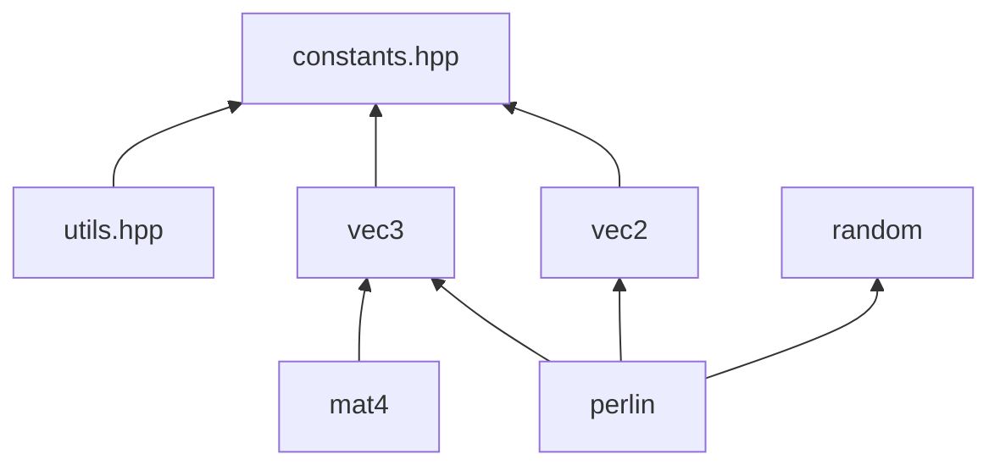
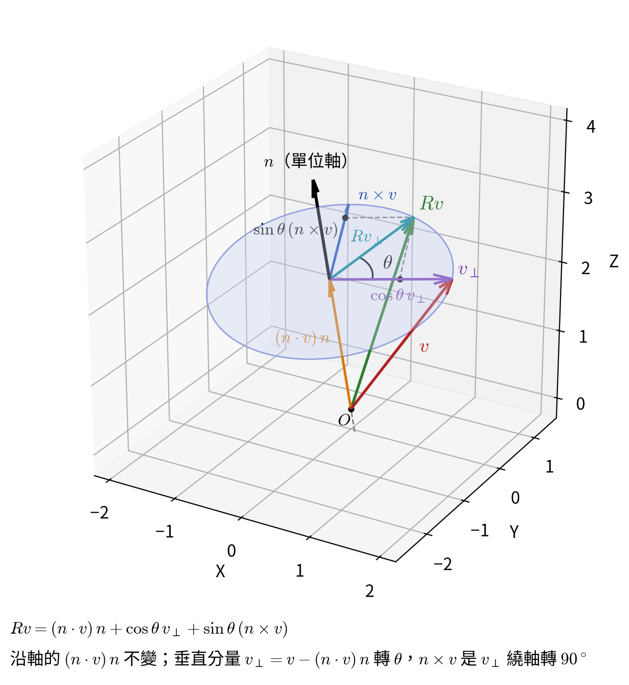

# math

不依賴其他模組的數學函式庫：向量與矩陣、角度與內插、可重現的亂數與雜訊。全部位於 `robot` namespace。曲線與路徑等幾何物件在 [geometry/curve](../geometry/curve/README.md)，同樣遵守這裡的約定。



箭頭是 header 之間的 include。`utils` 只在各模組的 `.cpp` 裡使用，不會經由其他 header 傳出去。

## 共通約定

| 項目     | 約定                                                                                             |
| -------- | ------------------------------------------------------------------------------------------------ |
| 角度     | 介面一律用**度**，與 `glRotatef` 相同；需要弧度時用 `radians()` 轉換                             |
| 座標系   | 右手座標系，`cross(X, Y) = Z`；2D 的正角度為逆時針                                               |
| 矩陣     | column-major，與 OpenGL 相同；作用在行向量上，$(AB)\,v = A(Bv)$                                  |
| 浮點比較 | `Vec2`、`Vec3` 的 `==` 容許每個分量相差 `EPSILON` $= 10^{-6}$                                    |
| 曲線參數 | $t \in [0, 1]$，$t = 0$ 為起點、$t = 1$ 為終點                                                   |
| 命名     | 幾何型別一律帶維度後綴（`LineSegment2D`、`Arc2D`）；向量、矩陣沿用 GLSL 的名稱（`Vec3`、`Mat4`） |
| 函式     | 向量與矩陣是純資料的 struct 搭配自由函式，例如 `dot(a, b)`；曲線是 class，各種曲線提供同名的成員函式 |

## 向量：`vec2.hpp`、`vec3.hpp`

`Vec2`、`Vec3` 支援加減、純量乘除與取負號。自由函式：

| 函式                             | 定義                                                              |
| -------------------------------- | ----------------------------------------------------------------- |
| `length(v)` / `lengthSquared(v)` | $\lVert v \rVert$ / $\lVert v \rVert^2$                           |
| `distance(a, b)`                 | $\lVert b - a \rVert$                                             |
| `dot(a, b)`                      | $a \cdot b$                                                       |
| `cross(a, b)`                    | 3D：$a \times b$；2D：$a_x b_y - a_y b_x$，即 3D 外積的 $z$ 分量  |
| `normalize(v)`                   | $v / \lVert v \rVert$；$\lVert v \rVert <$ `EPSILON` 時回傳零向量 |

2D 外積的正負號表示 $b$ 在 $a$ 的哪一側：正值時 $b$ 在 $a$ 的左手邊（逆時針方向）。

## 矩陣：`mat4.hpp`

`Mat4` 以 `m[col * 4 + row]` 儲存，`data()` 可以直接交給 `glMultMatrixf`。預設建構為單位矩陣。

**平移** `translation(d)`：

$$
T(d) = \begin{bmatrix} 1 & 0 & 0 & d_x \\ 0 & 1 & 0 & d_y \\ 0 & 0 & 1 & d_z \\ 0 & 0 & 0 & 1 \end{bmatrix}
$$

**旋轉** `rotation(θ, axis)`：繞單位軸 $n$ 轉 $\theta$，與 `glRotatef` 建立的矩陣相同。`axis` 不必是單位向量，函式內會先正規化。

把向量 $v$ 拆成平行於軸與垂直於軸的兩部分：平行的部分繞軸轉也不變；垂直的部分在垂直於軸的平面上轉 $\theta$，和 2D 旋轉一樣，由「原方向」與「轉 90° 的方向」以 $\cos\theta$、$\sin\theta$ 組合而成：

$$
R\,v = \underbrace{(n \cdot v)\,n}_{\text{沿軸的分量，不動}}
+ \cos\theta\,\underbrace{\bigl(v - (n \cdot v)\,n\bigr)}_{\text{垂直於軸的分量}}
+ \sin\theta\,\underbrace{(n \times v)}_{\text{垂直分量轉 90°}}
$$



把投影寫成 $(n \cdot v)\,n = n n^{\mathsf T} v$、外積寫成 $n \times v = [n]_\times v$，上式整理成矩陣：

$$
R = c\,I + t\,n n^{\mathsf T} + s\,[n]_\times,
\qquad
[n]_\times = \begin{bmatrix} 0 & -n_z & n_y \\ n_z & 0 & -n_x \\ -n_y & n_x & 0 \end{bmatrix}
$$

其中 $c = \cos\theta$、$s = \sin\theta$、$t = 1 - c$。展開後就是 `rotation()` 逐項填入的矩陣：

$$
R = \begin{bmatrix}
c + n_x^2\,t & n_x n_y\,t - n_z\,s & n_x n_z\,t + n_y\,s \\
n_y n_x\,t + n_z\,s & c + n_y^2\,t & n_y n_z\,t - n_x\,s \\
n_z n_x\,t - n_y\,s & n_z n_y\,t + n_x\,s & c + n_z^2\,t
\end{bmatrix}
$$

軸取 $z$ 軸 $n = (0, 0, 1)$ 時，它就化為繞 $z$ 軸的旋轉矩陣 $\begin{bmatrix} c & -s & 0 \\ s & c & 0 \\ 0 & 0 & 1 \end{bmatrix}$。

**變換**：`transformPoint` 把點視為 $w = 1$，會受平移影響；`transformVector` 把向量（方向、位移、兩點的差）視為 $w = 0$，只受左上 $3 \times 3$ 影響，不會正規化。

## 純量工具：`utils.hpp`

### 角度

| 函式                            | 結果                                                        |
| ------------------------------- | ----------------------------------------------------------- |
| `radians(deg)` / `degrees(rad)` | $\text{deg} \cdot \pi / 180$ / $\text{rad} \cdot 180 / \pi$ |
| `wrapDegrees(a)`                | 同方向、落在 $[0, 360)$ 的角度                              |
| `wrapSignedDegrees(a)`          | 同方向、落在 $(-180, 180]$ 的角度，用來判斷往哪邊轉比較近   |

### 內插

`lerp(a, b, t)` $= a + (b - a)\,t$，適用 `float`、`Vec2`、`Vec3` 等支援這些運算的型別。$t$ 不限制在 $[0, 1]$。

`approach(rate, dt)` 讓數值以指數方式趨近目標，用在視線轉向、身體轉向與走路動畫的強度。速度與差距成正比，越接近越慢；與幀率無關，也不會越過目標：

```cpp
current += (target - current) * approach(rate, dt);
```

$$
\text{approach}(r, \Delta t) = 1 - e^{-r\,\Delta t}
$$

`rate` 的單位是 1/秒，越大追得越快：約 $3 / r$ 秒追上 95%，$13.8 / r$ 秒追上 $1 - 10^{-6}$。例如 rate = 10 約 0.3 秒看起來到了。

公式的推導、`rate` 的選法與追上時間的計算見 [approach.md](approach.md)。

`smoothStep(a, b, t)` 在 $t \le a$ 時為 0、$t \ge b$ 時為 1，中間以 S 形曲線平滑過渡，兩端的斜率都是 0，用來做沒有折角的遮罩：

$$
s = \text{clamp}\!\left(\frac{t - a}{b - a},\ 0,\ 1\right), \qquad \text{smoothStep}(a, b, t) = 3s^2 - 2s^3
$$

$a = b$ 時會除以 0。

### 整數除法

C++ 的 `/` 向 0 取整，`-7 / 2 == -3`。`floorDiv` 向 $-\infty$ 取整，`ceilDiv` 向 $+\infty$ 取整：

$$
\text{floorDiv}(-7, 2) = \lfloor -3.5 \rfloor = -4, \qquad \text{ceilDiv}(-7, 2) = \lceil -3.5 \rceil = -3
$$

需要整數取整的換算（例如字型的單位換成像素）用這兩個函式，負值才不會差 1。

## 亂數：`random.hpp`

`Random` 是**無狀態**的雜湊式亂數：同樣的 seed、座標、`stream`、`index` 永遠得到同樣的 64 位元值，與呼叫順序無關。

```cpp
const Random random(seed);
std::uint64_t v = random.valueAt2D(x, z, TREE_STREAM, 0);       // 這一格的第 0 個值
std::uint32_t n = Random::uniformInt(v, 1, 6);                 // [1, 6]
double h = Random::uniformFloat(random.valueAt1D(x), 0.0, 1.0);  // [0, 1)
```

- `stream`：用途，例如地形與樹木各用一個，彼此的值無關
- `index`：同一用途、同一座標下要第幾個值

`valueAt2D(x, y, stream, index)` 的計算過程如下，其他維度只差在座標的個數：

$$
\begin{aligned}
v &= \text{mix}(\text{seed} \oplus D_{2}) && \text{從 seed 開始，依維度加上不同常數} \\
v &= \text{mix}(v \oplus x) && \text{依序混入每個座標} \\
v &= \text{mix}(v \oplus y) \\
v &= \text{mix}(v \oplus S \oplus \text{stream}) && \text{混入用途} \\
\text{結果} &= \text{mix}(v \oplus I \oplus \text{index}) && \text{混入序號}
\end{aligned}
$$

| 符號                 | 意思                                                                                   |
| -------------------- | -------------------------------------------------------------------------------------- |
| $\text{mix}$         | 把 64 位元打散的混合函式（SplitMix64 的 finalizer），輸入只差 1 位元，輸出也會大幅改變 |
| $D_0, D_1, D_2, D_3$ | 依維度選用的固定常數                                                                   |
| $S$、$I$             | 標記 stream 與 index 的固定常數，讓它們與座標的值不會互相抵消                          |

每混入一項就 mix 一次，所以任何一項改變都會讓結果完全不同。各維度的起始常數不同，`valueAt1D(5)` 與 `valueAt2D(5, 0)` 也互不相關。

**`uniformInt(v, min, max)`**：區間含兩端，共 $N = \text{max} - \text{min} + 1$ 個值。直接取 $v \bmod N$ 時，若 $2^{64}$ 不能被 $N$ 整除，較小的結果會稍微常出現。因此小於 $2^{64} \bmod N$ 的值會被丟棄重抽，剩下的範圍長度是 $N$ 的倍數，分布才均勻。

**`uniformFloat(v, min, max)`**：取 $v$ 的高 53 位元，剛好是 `double` 尾數的位數：

$$
u = \lfloor v / 2^{11} \rfloor \cdot 2^{-53} \in [0, 1), \qquad \text{result} = \text{min} + (\text{max} - \text{min})\,u
$$

## 雜訊：`perlin.hpp`

`Perlin1D`、`Perlin2D`、`Perlin3D` 是 Perlin 梯度雜訊。每個整數格點的梯度只由 seed 與格點座標決定（透過 `Random`），所以分開生成的相鄰區塊在共用邊界上的值相同。

取樣點 $p$ 所在格子的每個角落 $c$ 有梯度 $g_c$，先算出角落的貢獻 $g_c \cdot (p - c)$，再以平滑曲線內插：

$$
f(t) = 6t^5 - 15t^4 + 10t^3
$$

$f$ 在 $t = 0$ 與 $t = 1$ 的一階、二階導數都是 0，跨格子時曲面平滑相接，不會出現折痕。整數格點上 $p - c = 0$，雜訊值為 0。

內插結果的範圍隨維度與梯度長度而不同，`noise()` 會再乘上一個倍數，讓三個維度的輸出範圍都是 $[-1, 1]$。呼叫端不必記各自的範圍，映射到 $[0, 1]$ 一律是 `n * 0.5f + 0.5f`。

| 類別       | 梯度                                                               | 內插結果範圍       | 倍數      |
| ---------- | ------------------------------------------------------------------ | ------------------ | --------- |
| `Perlin1D` | 斜率取 $[-1, 1)$ 的隨機值                                          | $[-0.5, 0.5]$      | $2$       |
| `Perlin2D` | 單位圓上 16 個等分方向                                             | 約 $[-0.71, 0.71]$ | $\sqrt2$  |
| `Perlin3D` | 立方體 12 條邊中點的方向（長度 $\sqrt2$），補 4 個重複的湊滿 16 個 | 約 $[-1, 1]$       | $1$       |

1D 的斜率若只有 $\pm 1$，每一格的起伏都一樣高，看得出週期，所以斜率大小也取隨機值。

$[-1, 1]$ 是理論上界，實際的值大多落在 0 附近，很少接近 $\pm 1$。

建構子的第二個參數是 `Random` 的 `stream`，預設每個維度各用一個。同一個 seed 需要多組互不相關的雜訊時（例如地形高度與濕度），傳入不同的 `stream` 即可。

### 分形疊加：`fbm()`

`fbm(p, octaves, lacunarity, gain)` 把 `octaves` 層 `noise()` 疊起來，每層頻率乘以 `lacunarity`（預設 2）、振幅乘以 `gain`（預設 0.5），讓同一組雜訊同時有大起伏與小細節。結果除以總振幅：

$$
\text{fbm}(p) = \frac{\sum_{i=0}^{n-1} g^i \cdot \text{noise}(l^i p + i\,o)}{\sum_{i=0}^{n-1} g^i}
$$

$o$ 是固定的偏移量（`OCTAVE_OFFSET`）。若不錯開，每層在原點都是 0，格點也會互相對齊。

除以總振幅保證輸出不超出 $[-1, 1]$，但各層互不相關、會互相抵消，實際的值比單層更集中在 0 附近：實測 `Perlin2D` 疊 4 層時，99% 的值落在約 $\pm 0.43$ 內。需要接近 $[-1, 1]$ 的範圍時乘以 2，需要 $[0, 1]$ 時加 0.5，而不是 `noise()` 的 `n * 0.5f + 0.5f`。
