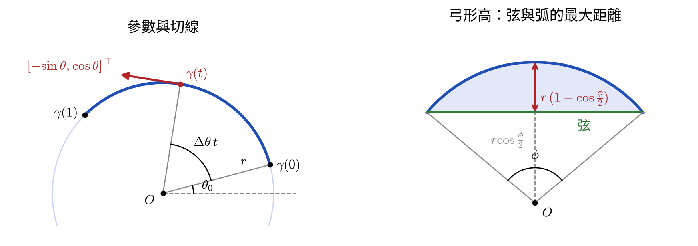
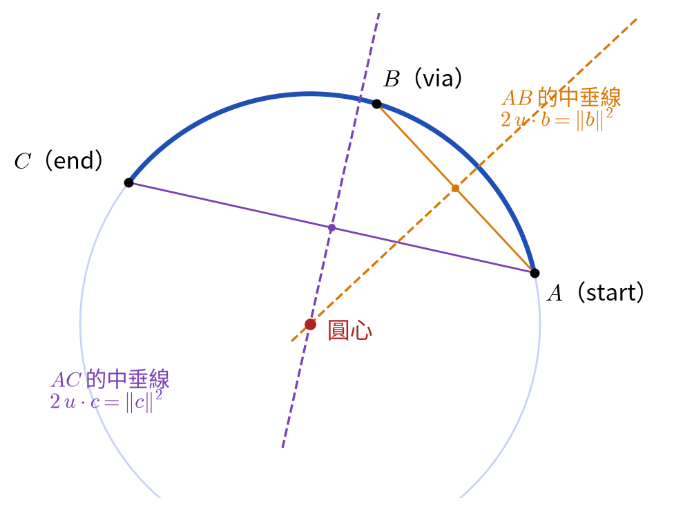
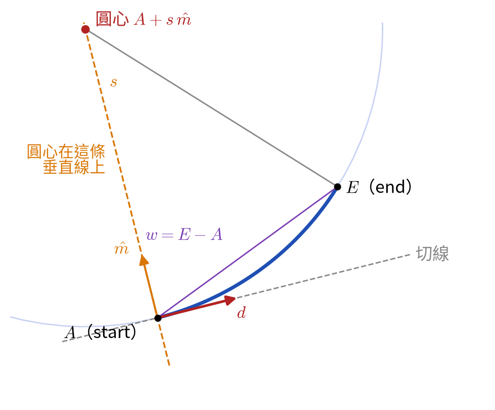
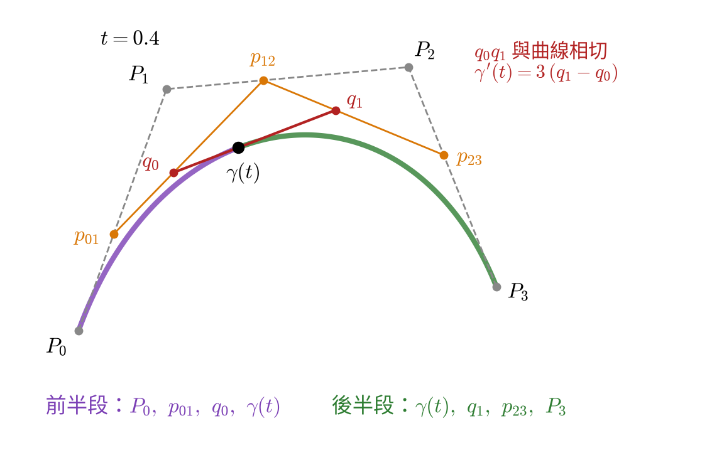
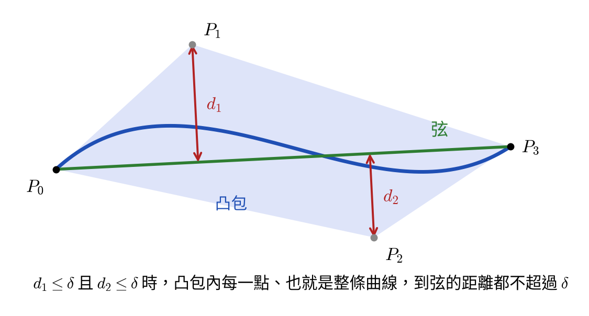
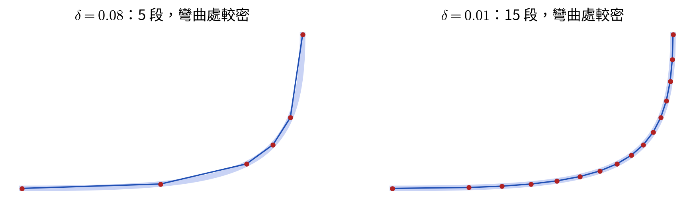
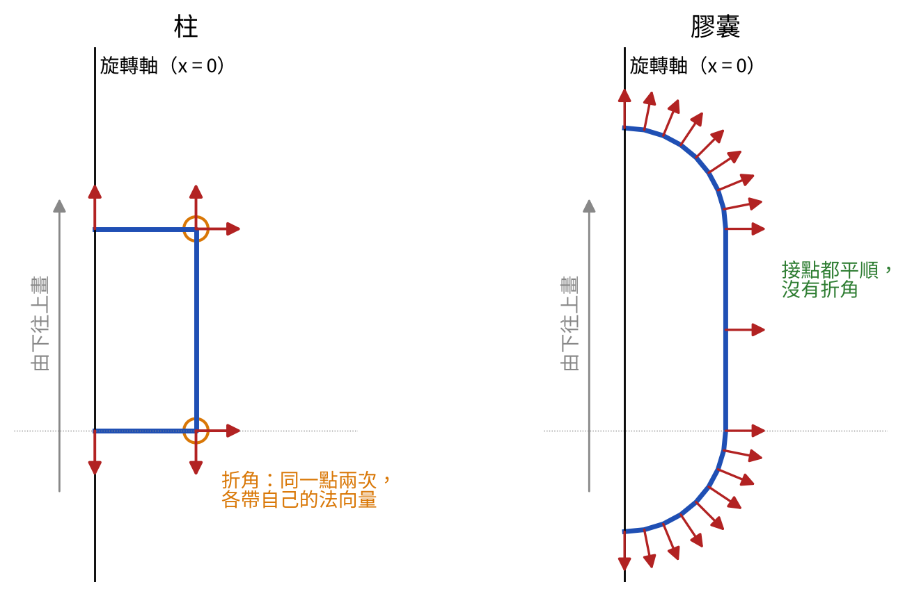

# curve

2D 曲線與路徑。曲線有線段、圓弧、二次與三次貝茲曲線；`Path2D` 用畫筆指令把它們接成一條路徑，再切成帶法向量的折線，作為旋轉成曲面時的剖面。另有 3D 的線段。

| 檔案               | 內容                                 |
| ------------------ | ------------------------------------ |
| `line_segment.hpp` | `LineSegment2D`、`LineSegment3D`     |
| `arc.hpp`          | `Arc2D`                              |
| `bezier.hpp`       | `QuadraticBezier2D`、`CubicBezier2D` |
| `curve.hpp`        | `Curve2D`：上述任一種 2D 曲線        |
| `flatten.hpp`      | `flatten`：把任一種曲線切成折線      |
| `path2d.hpp`       | `Path2D`                             |

角度單位與座標系等約定見 [math/README.md](../README.md#共通約定)。

## 符號

| 符號         | 意思                                |
| ------------ | ----------------------------------- |
| $t$          | 曲線的參數，0 為起點、1 為終點      |
| $\gamma(t)$  | 曲線上參數為 $t$ 的點               |
| $\gamma'(t)$ | 對 $t$ 的導數                       |
| $\delta$     | 切成折線時容許的誤差（`tolerance`） |

各曲線另外用到的符號在該節說明。

## 1. 共同介面

每種曲線都提供同名的成員函式：

| 函式                         | 意思                                                    |
| ---------------------------- | ------------------------------------------------------- |
| `startPoint()`、`endPoint()` | 起點 $\gamma(0)$、終點 $\gamma(1)$                      |
| `evaluate(t)`                | 曲線上的點 $\gamma(t)$                                  |
| `derivative(t)`              | $\gamma'(t)$：$t$ 增加時點移動的方向與快慢              |
| `tangent(t)`                 | 單位切線：曲線往哪個方向延伸                            |
| `split(t)`                   | 在 $t$ 處切成兩段同種類的曲線                           |
| `isFlat(δ)`                  | 用起點到終點的弦代替這段曲線時，誤差是否不超過 $\delta$ |

**`derivative` 與 `tangent`**：把 $t$ 想成時間，`derivative` 是點沿曲線移動的速度，`tangent` 只取它的方向。兩者在點停下來時不同：貝茲曲線的控制點與端點重合時，端點的導數為 0，但曲線仍朝某個方向延伸，`tangent` 回傳那個方向。

**`split` 與 `isFlat`** 是切成折線用的，見第 5 節。

## 2. 線段

從 $A$ 到 $B$：

$$
\gamma(t) = (1 - t)\,A + t\,B, \qquad \gamma'(t) = B - A
$$

導數與 $t$ 無關，`tangent` 是 $B - A$ 的方向；長度為 0 時是零向量。線段本身是直的，`isFlat` 一律為 true。

**點到線段的距離** `distance(Q)`：先求 $Q$ 投影到直線上的參數，再夾到 $[0, 1]$，最近點就是那個參數對應的點：

$$
t^* = \operatorname{clamp}\!\left(\frac{(Q - A) \cdot (B - A)}{\lVert B - A \rVert^2},\ 0,\ 1\right),
\qquad d = \lVert Q - \gamma(t^*) \rVert
$$

長度為 0 時分母為 0，距離直接取 $\lVert Q - A \rVert$。

## 3. 圓弧

圓心 $O$、半徑 $r$、起始角 $\theta_0$、轉角 $\Delta\theta$（正值逆時針）。$t$ 與轉過的角度成正比：

$$
\theta(t) = \theta_0 + \Delta\theta\,t,
\qquad
\gamma(t) = O + r\,\bigl[\cos\theta(t),\ \sin\theta(t)\bigr]^{\mathsf T}
$$



### 導數與切線

$O$ 是常數，微分後為 0；$\cos\theta$、$\sin\theta$ 依連鎖律多乘出 $\theta'(t) = \Delta\theta$：

$$
\gamma'(t) = r\,\Delta\theta\,\bigl[-\sin\theta(t),\ \cos\theta(t)\bigr]^{\mathsf T}
$$

$[-\sin\theta, \cos\theta]^{\mathsf T}$ 是從圓心指向該點的方向逆時針轉 90°，即圓的切線。長度 $r\,\lvert\Delta\theta\rvert$ 是整段圓弧的長度：$t$ 從 0 到 1 等速走完整段弧。$\Delta\theta$ 須以弧度計算，正負號同時決定切線的方向；`tangent` 在順時針時把方向反過來。

### 切開與判斷平坦

`split(t)` 切開後兩段的圓心與半徑不變，第一段轉 $\Delta\theta\,t$，第二段從那裡接著轉剩下的角度。

轉 $\phi$ 的弦與圓弧的最大距離在弦的中點，是弓形高：

$$
r\left(1 - \cos\frac{\phi}{2}\right)
$$

`isFlat(δ)` 判斷它是否不超過 $\delta$。

### 建立方式

除了直接給定圓心、半徑與角度，還能由其他條件求出圓弧。求不出來時回傳 `std::nullopt`。

| 函式                                    | 給的條件                         | 求不出來的情況                    |
| --------------------------------------- | -------------------------------- | --------------------------------- |
| `around(start, center, sweep)`          | 起點、圓心、轉角                 | 起點與圓心重合                    |
| `around(start, center, end, clockwise)` | 起點、圓心、終點的方向           | 起點或終點與圓心重合              |
| `through(start, via, end)`              | 弧上的三點                       | 三點共線或兩點重合                |
| `tangentAtStart(start, direction, end)` | 起點、在起點的前進方向、終點     | 終點落在起點沿 direction 的直線上 |
| `tangentAtEnd(start, end, direction)`   | 起點、終點、到達終點時的前進方向 | 起點落在終點沿 direction 的直線上 |

**`around`**：半徑為起點到圓心的距離，起始角為 $\operatorname{atan2}$ 求出的起點方向。給終點的版本只用終點決定方向，終點不必在圓上；轉角是依旋轉方向從起點方向量到終點方向的角度，兩者方向相同時轉一整圈。

**`through`**：以 $A$（start）為原點，$b = B - A$、$c = C - A$（$B$ 為 via、$C$ 為 end），所求圓心為 $A + u$。圓心到三點等距，由 $\lVert u \rVert = \lVert u - b \rVert$ 兩邊平方展開得

$$
2\,u \cdot b = \lVert b \rVert^2, \qquad 2\,u \cdot c = \lVert c \rVert^2
$$

每條都是一條中垂線。這是 $u$ 的二元一次方程組，以克拉瑪公式求解，分母為外積 $b \times c = b_x c_y - b_y c_x$：

$$
u = \frac{1}{2\,(b \times c)}
\begin{bmatrix} c_y \lVert b \rVert^2 - b_y \lVert c \rVert^2 \\ b_x \lVert c \rVert^2 - c_x \lVert b \rVert^2 \end{bmatrix}
$$

$b \times c = 0$ 時兩條中垂線平行，即三點共線或有兩點重合。$b \times c > 0$ 時 $A \to B \to C$ 為逆時針，圓弧也逆時針轉，這樣才會經過 via。



**`tangentAtStart`**：圓在起點 $A$ 的切線是 $d$（direction），半徑垂直於切線，所以圓心在通過 $A$、垂直於 $d$ 的直線上。令 $\hat m$ 為 $d$ 往左轉 90° 的單位向量，圓心為 $A + s\,\hat m$。令 $w = E - A$（$E$ 為 end），由圓心到 $A$、$E$ 等距：

$$
s^2 = \lVert s\,\hat m - w \rVert^2
\quad\Longrightarrow\quad
s = \frac{\lVert w \rVert^2}{2\,(\hat m \cdot w)}
$$

$\hat m \cdot w = 0$ 時 $E$ 在切線上，需要無限大的圓。$s > 0$ 時圓心在左邊，往左彎，為逆時針。



**`tangentAtEnd`**：同樣的做法，改以終點 $E$ 為基準：圓心為 $E + s\,\hat m$，$w = A - E$。

## 4. 貝茲曲線

控制點 $P_0, \ldots, P_n$（二次 $n = 2$，三次 $n = 3$）。曲線從 $P_0$ 出發、到達 $P_n$，中間的控制點決定彎曲的方向，曲線不一定經過它們。

### 求值：de Casteljau

相鄰兩點以 $t$ 內插得到新的一層點，重複到只剩一點，就是 $\gamma(t)$。以三次為例：

$$
\begin{aligned}
p_{01} &= \operatorname{lerp}(P_0, P_1, t), & p_{12} &= \operatorname{lerp}(P_1, P_2, t), & p_{23} &= \operatorname{lerp}(P_2, P_3, t) \\
q_0 &= \operatorname{lerp}(p_{01}, p_{12}, t), & q_1 &= \operatorname{lerp}(p_{12}, p_{23}, t) \\
\gamma(t) &= \operatorname{lerp}(q_0, q_1, t)
\end{aligned}
$$

`split(t)` 用的也是這些點：前半段的控制點是每一層的第一點 $(P_0, p_{01}, q_0, \gamma(t))$，後半段是每一層的最後一點 $(\gamma(t), q_1, p_{23}, P_3)$。



### 導數

最後一層的兩點連線與曲線相切，導數是它們的差乘以次數：

$$
\gamma'(t) = n\,(q_1 - q_0)
$$

二次時 $q_0$、$q_1$ 換成 $p_{01}$、$p_{12}$。在端點有簡單的形式：三次時 $\gamma'(0) = 3\,(P_1 - P_0)$、$\gamma'(1) = 3\,(P_3 - P_2)$，所以曲線在起點朝向 $P_1$、在終點來自 $P_2$。

### 切線的退化情況

控制點與端點重合時，端點的導數為 0。`tangent` 改取曲線實際延伸的方向：

- **二次**：$P_1$ 與 $P_0$ 或 $P_2$ 重合時，整條曲線就是 $P_0$ 到 $P_2$ 的直線，例如 $P_1 = P_0$ 時 $\gamma(t) = P_0 + t^2\,(P_2 - P_0)$，切線處處為 $P_2 - P_0$ 的方向。
- **三次**：在起點依序找 $P_1, P_2, P_3$ 中第一個不與 $P_0$ 重合的點，切線指向它；終點則從 $P_2$ 往回找。

所有點重合，或曲線在中間折返的尖點，切線是零向量。

### 判斷平坦

貝茲曲線位於控制點圍成的凸包內。若中間的控制點到弦 $P_0 P_n$ 的距離都不超過 $\delta$，凸包內的每一點都是如此，曲線也就不會超出。`isFlat` 因此只需檢查中間控制點到弦的距離。



## 5. 切成折線：`flatten`

```cpp
std::vector<CurveSample2D> samples;
flatten(curve, tolerance, samples);
```

不夠平就對半切，兩半各自再檢查；彎曲處自然切得較細：

```
flatten(曲線, δ, t0, t1):
    曲線.isFlat(δ)：加入 (曲線.endPoint(), t1)
    否則：前半, 後半 = 曲線.split(0.5)
          tm = (t0 + t1) / 2
          flatten(前半, δ, t0, tm)
          flatten(後半, δ, tm, t1)
```

`t0`、`t1` 記錄子曲線在原曲線上的參數範圍，每個點因此帶著原曲線的 $t$，可再拿去求切線。

| 規則       | 說明                                                                                        |
| ---------- | ------------------------------------------------------------------------------------------- |
| 輸出       | 起點（$t = 0$）、各段的分界點與終點（$t = 1$），接在 `samples` 原有的內容之後               |
| 誤差       | 每段弦與曲線的距離不超過 $\delta$                                                           |
| 上限       | 最多遞迴 10 層，即 1024 段，避免 $\delta \le 0$ 時無限遞迴；到達上限時誤差可能超過 $\delta$ |
| 曲線的要求 | 提供 `startPoint`、`endPoint`、`split`、`isFlat`                                            |

圓弧每次對半切時轉角減半，段數是 2 的冪。例如 $\delta = 1$ mm 時，半徑 5 cm 的半圓切成 8 段，半徑 25 cm 的切成 32 段。



## 6. `Curve2D`

任一種 2D 曲線，內部以 `std::variant` 存放實際的曲線，成員函式轉呼叫實際曲線的同名函式。建構子不加 `explicit`，各種曲線可直接轉成 `Curve2D`：

```cpp
std::vector<Curve2D> curves;
curves.push_back(LineSegment2D(a, b));
curves.push_back(arc);
```

`Curve2D` 本身也提供第 1 節的介面，可以直接交給 `flatten`。

## 7. 路徑：`Path2D`

畫筆從起點開始，每個指令從畫筆目前的位置畫一段，畫完後畫筆移到該段的終點：

| 指令                                     | 加入的曲線                                                                                |
| ---------------------------------------- | ----------------------------------------------------------------------------------------- |
| `lineTo(end)`                            | 線段                                                                                      |
| `arcTo(center, end, clockwise)`          | `Arc2D::around`：繞 center 轉到 end 的方向，畫筆停在圓弧實際的終點                        |
| `tangentArcTo(end)`                      | `Arc2D::tangentAtStart`，方向取上一段終點的切線，與上一段平滑相接；end 在切線上時改畫直線 |
| `quadraticBezierTo(control, end)`        | 二次貝茲曲線                                                                              |
| `cubicBezierTo(control1, control2, end)` | 三次貝茲曲線                                                                              |

### 切成帶法向量的折線

`flatten(δ)` 依序切開每一段，每個點的法向量由該段曲線在那一點的切線 $(t_x, t_y)$ 往右轉 90° 得到：$(t_y, -t_x)$。

兩段相接時比較接點兩側的法向量：

- **夾角在 1° 以內**：視為平順，只保留一個頂點，旋轉後表面是圓滑的。
- **超過 1°**：視為折角，同一位置連續出現兩次，各帶自己的法向量，旋轉後在這裡形成銳利的邊。

切線由 $\sin$、$\cos$ 等算出，平順的接點兩側也不會剛好相等，所以用夾角判斷。長度為 0 的段沒有方向，會略過。

### 剖面的畫法

法向量在前進方向的右手邊，所以旋轉體的剖面要畫在 $x \ge 0$ 的一側、**由下往上**，法向量才會朝外。剖面的兩端落在軸上（$x = 0$）時，旋轉後成為封閉的曲面：

```cpp
// 球：半徑 r 的半圓
Path2D(Vec2(0, -r)).arcTo(Vec2(0, 0), Vec2(0, r));

// 柱：底蓋、側面、頂蓋，兩個轉角都是折角
Path2D(Vec2(0, 0)).lineTo(Vec2(r, 0)).lineTo(Vec2(r, h)).lineTo(Vec2(0, h));

// 膠囊：圓弧與直線相切，整條剖面都是平順的
Path2D(Vec2(0, -r)).arcTo(Vec2(0, 0), Vec2(r, 0)).lineTo(Vec2(r, h)).arcTo(Vec2(0, h), Vec2(0, h + r));
```

柱切出 6 個頂點，法向量依序朝下、朝外、朝上；球與膠囊則沒有折角。


